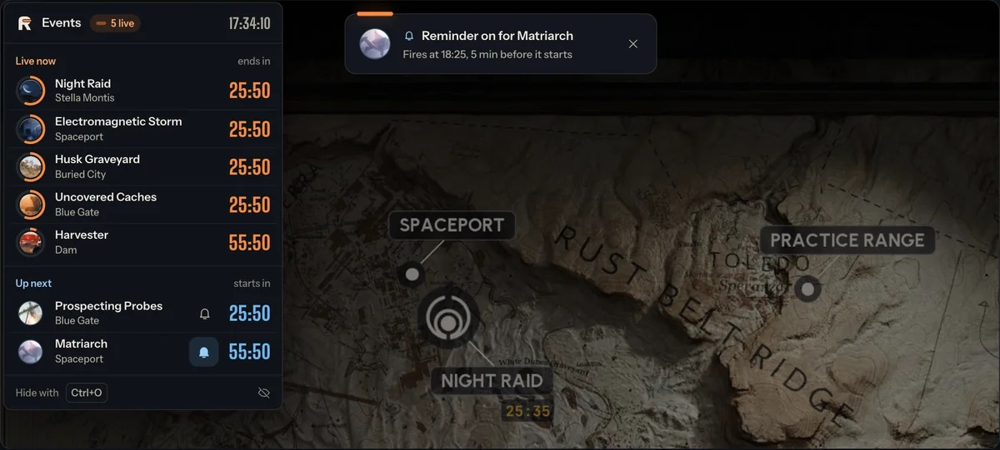
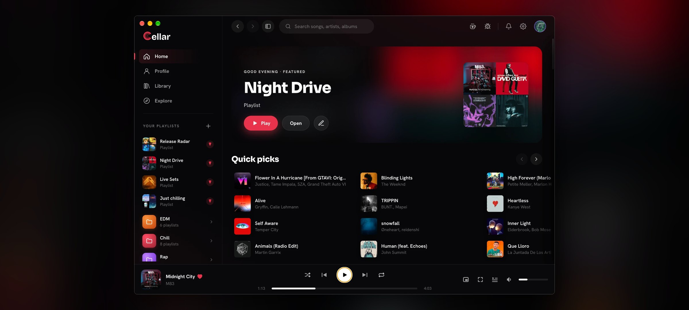

I'm a full-stack software engineer. I build products end to end, from frontend and backend to native code and the release pipeline. My own apps, RaiderBuddy and Cellar, have **290K+ downloads** across **125+ releases**.

## Apps I'm working on

<table>
  <tr>
    <td width="50%" valign="top">
      
      <h3><a href="https://github.com/timlangner/RaiderBuddy">RaiderBuddy</a></h3>
      
The companion app for ARC Raiders. Live event timers for every server region, interactive maps, quests, items and a skill tree planner, in the browser and as an overlay on top of the game.

      

        
        
      

      

        
        
      

      <b>Built with</b> Next.js, React, Supabase, Leaflet, Electron and Rust
    </td>
    <td width="50%" valign="top">
      
      <h3><a href="https://github.com/timlangner/cellar">Cellar</a></h3>
      
The YouTube Music desktop app Google never made. Playlist folders, listening parties with friends, year-round listening stats, Discord Rich Presence, Last.fm scrobbling and so much more.

      

        
        
      

      

        
        
        
      

      <b>Built with</b> Electron, React, TypeScript, Python (FastAPI) and Astro
    </td>
  </tr>
</table>

## How I build with AI

I work with AI coding agents every day. This is the setup behind it:

<table>
  <tr>
    <td><b>Agents</b></td>
    <td>Claude Code and Cursor, often several at once, locally in separate git worktrees or as cloud agents.</td>
  </tr>
  <tr>
    <td><b>Repo&nbsp;context</b></td>
    <td>Each active repo has a <code>CLAUDE.md</code> or <code>AGENTS.md</code> with build commands, architecture notes and past decisions.</td>
  </tr>
  <tr>
    <td><b>Custom&nbsp;skills</b></td>
    <td>Skills and commands for recurring work, like end to end testing, shipping new releases and opening draft PRs.</td>
  </tr>
  <tr>
    <td><b>Guardrails</b></td>
    <td>Bug reports from users go to a separate read-only agent. The agent that writes code only gets its summary, never the raw report.</td>
  </tr>
  <tr>
    <td><b>Integrations</b></td>
    <td>MCP servers for Notion, Blender, Playwright, Supabase and many more, including custom ones. My apps also serve <code>llms.txt</code> for AI assistants.</td>
  </tr>
</table>

## Tech stack

<table>
  <tr>
    <td><b>Languages</b></td>
    <td></td>
  </tr>
  <tr>
    <td><b>Apps&nbsp;and&nbsp;web</b></td>
    <td></td>
  </tr>
  <tr>
    <td><b>Backend&nbsp;and&nbsp;infra</b></td>
    <td></td>
  </tr>
  <tr>
    <td><b>AI&nbsp;tooling</b></td>
    <td></td>
  </tr>
</table>

## Get in touch

For questions, ideas or work, email me at **[tim.langner0@gmail.com](mailto:tim.langner0@gmail.com)**.
